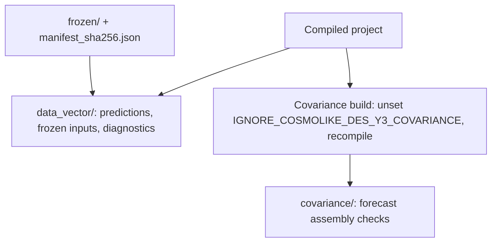

# Tests

The DES Y3 tests and optional studies are organized as follows.

- [Data-vector and likelihood checks](data_vector/README.md) cover the project
  predictions, frozen inputs and numerical diagnostics.
- [Covariance checks](covariance/README.md) cover forecast assembly and its
  documented component checks. Covariance generation must be compiled.
- <a name="optional_studies"></a>[Optional studies](studies/README.md#optional_studies)
  compare n(z) reconstructions and numerical accuracy, with plots and
  $\Delta\chi^2$ results. Run them separately from the routine tests.



The data-vector sector includes the setting-sequence tests
(`data_vector/test_setting_sequences.py`): they change cosmolike
settings in one process, as a notebook does between evaluations, and
compare every result bit for bit with a separate process that saw only
the final settings. A change the loaded data layout cannot follow must
stop with a clear message instead of returning numbers computed from
the earlier settings.

We assume Cocoa and this project are installed, the Cocoa Conda environment
is active, the shell is Bash, and the current folder is `cocoa/Cocoa/`.

Run the sectors in separate Python invocations: they initialize different
compiled-library state. Running one project at a time also avoids importing
another project's same-named test helpers.

**Step :one:**: activate Cocoa.

```bash
source start_cocoa.sh
```

**Step :two:**: run the data-vector sector.

```bash
python -m pytest ./projects/des_y3/tests/data_vector
```

**Step :three:**: enable covariance generation.

```bash
unset IGNORE_COSMOLIKE_DES_Y3_COVARIANCE
```

**Step :four:**: compile the project.

```bash
source ./projects/des_y3/scripts/compile_des_y3.sh
```

**Step :five:**: run the covariance sector.

```bash
python -m pytest ./projects/des_y3/tests/covariance
```

The project must be enabled in `set_installation_options.sh` before
activation. A covariance skip in a deliberately disabled build is expected;
it is not a successful covariance check. Read the sector guide to distinguish
asserted regressions from advisory accuracy reports.

Frozen configurations and inputs are protected by `manifest_sha256.json`.
Do not regenerate references to silence an unexplained failure. The
[data-vector guide](data_vector/README.md#refreeze) documents the deliberate
reference-update procedure and its limits.

Hybrid examples can be checked without sampling:

**Step :one:**: check configuration 1.

```bash
python ./projects/des_y3/EXAMPLE_EMUL2_MINIMIZE1.py --check
```

**Step :two:**: check configuration 2.

```bash
python ./projects/des_y3/EXAMPLE_EMUL2_MINIMIZE2.py --check
```

## Matter-emulator prior comparison <a name="matter_emulator_prior"></a>

[compare_emulator_camb.py](compare_emulator_camb.py) compares the candidate
matter-power emulator with CAMB through this project's existing likelihood.
It reads the fixed [benchmark](fisher_reference/) and its 50 broad and
25 focused cosmologies,
restricts $`0.2 < \Omega_m < 0.5`$, and fixes $`\sum m_\nu=0.06`$ eV.
For the broad-prior sample, nuisance parameters stay at the example's
declared evaluation point. Both
calculations use plain `mead2020` and CAMB background distances. The original
example and its production physics are not modified.

The installed emulator code and trained models are used by default. For
separate candidate checkouts, use the following commands from activated
Cocoa. The nonlinear files must exist under `emulmps/w0wa_mead2020/`
in the selected data checkout.

**Step :one:**: select the candidate code checkout.

```bash
export EMULATOR_CODE_DIR=/path/to/emulators_code
```

**Step :two:**: select the candidate model-data checkout.

```bash
export EMULATOR_DATA_DIR=/path/to/emulators_data_lcdm
```

**Step :three:**: choose the OpenMP thread count. The driver keeps BLAS
at one thread and sets TensorFlow before importing the numerical libraries.

```bash
export OMP_NUM_THREADS=4
```

**Step :four:**: run the comparison.

```bash
python projects/des_y3/tests/compare_emulator_camb.py
```

The shared routine is in `cosmolike_core/cocoa_testing.py`, following the
other project tests. A custom research draw uses seed $`137+i`$ for row
$`i`$. Use `--seed` and `--models` to request a new draw. BLAS remains at one thread.
The test uses the original CAMB likelihood route and the existing EMUL2
route. The selected example disables HOD galaxy spectra and halo-model IA;
its active power-spectrum calculations use total matter. EMUL2 also prepares
an approximate cold-matter table, but these selected observables do not
consume it. This comparison therefore does not validate halo observables,
a cold-matter emulator or a separate distance emulator. The existing
routes can also have different last tabulated wavenumbers and extrapolation
ranges. Their prediction difference measures integration into the project,
including those numerical choices; it does not isolate neural-network error.

The comparison statistic is the squared difference between predictions
weighted by the project's masked precision matrix,
$`\delta m^T C^{-1}\delta m`$. It is not the difference of their fit statistics
against the observations. The requested criterion is strictly below 1. The process exits
with status 1 if any point fails that criterion or cannot be evaluated.
Failed points are retained, never replaced by easier draws; broad-prior
points can lie outside the networks' coordinate ranges.

The driver writes these files under a new `chains/matter_emulator_points/` run directory.
`points.txt`, the two prediction arrays, `precision.npy`, `status.txt`,
`distances.txt`, `likelihood_relevance.txt`, and `summary.txt`. The source
YAML, effective reference YAML and provenance identify the inputs.
An explicit output directory resumes the same comparison checkpoints. Agreement at these points is useful for
an importance-sampling proposal, but does not establish adequate overlap
or effective sample size for an actual posterior chain.

The default example uses observed DES Y3 cosmic-shear data.
The likelihood-relevance table gives each CAMB fit penalty relative to the
best of the same prior draws, with every nuisance parameter fixed. This
can show that large emulator differences occur away from the better fits
on this slice. It is not a profile-likelihood or marginalized-posterior
exclusion test, and the prior draws are not posterior samples.

### Hybrid-emulator accuracy test

<!-- hybrid-emulator figure -->
The CAMB reference uses the saved benchmark's standard numerical controls and one
massive neutrino at $m_\nu=0.06$ eV. The same fixed tables supply 50 broad
points (open) and 25 focused points (filled) to both model routes.
The tables intersect the benchmark support with $0.2<\Omega_m<0.5$,
$1<10^9 A_s\le 3.5$, $H_0<85$ km/s/Mpc, $w_0>-2$ and
$\Omega_b(H_0/100)^2<0.035$. The solid and dashed curves show the saved
68% and 95% nuisance-marginalized Fisher regions.

CAMB uses `AccuracyBoost: 1.0`, `k_per_logint: 10` and `kmax: 5`. The saved
Fisher contours are approximate. The archived diagnostic found a maximum FoM
shift of 2.98%.


Counts use the thresholds 0.2, 0.5, 1 and 4 in that order.

| Case | Broad below threshold (50) | Focused below threshold (25) | Nonfinite broad/focused |
| --- | --- | --- | --- |
| DES Y3 | 39/41/42/44 | 22/22/24/24 | 0/0 |

<!-- end hybrid-emulator figure -->

E5 reads the saved `benchmark.yaml` in [fisher_reference/](fisher_reference/).
The benchmark fixes the likelihood, data selection, sampled parameters,
fiducial and normal numerical controls.

The accuracy test evaluates CAMB and the candidate at the fixed
[50 broad and 25 focused points](fisher_reference/) and stores both
vectors, the covariance-weighted error, and point status. Nuisance inputs are
held at the evaluate fiducial. Missing CAMB predictions or a comparison
with no valid vectors fails E5. The E5 adapter treats large prediction errors
as advisory. The strict standalone command also checks the error threshold.

```bash
python -m pytest projects/des_y3/tests/data_vector/test_emul2.py -k e5
```

To distribute the numerical comparisons across two MPI ranks with four
OpenMP threads each, use the same driver directly from activated Cocoa.
Keep BLAS at one thread and pass `--mpi` so the ranks own different points.

```bash
OMP_NUM_THREADS=4 OPENBLAS_NUM_THREADS=1 MKL_NUM_THREADS=1 \
  VECLIB_MAXIMUM_THREADS=1 mpirun -n 2 --bind-to none python -m mpi4py \
  projects/des_y3/tests/compare_emulator_camb.py --mpi --advisory
```

Saved Fisher contours show the bounded 68% and 95% regions of a centered
CAMB forecast with nuisance parameters marginalized. The saved reference
records the matrix, priors, fiducial, selection and numerical diagnostics.
The accuracy run uses the available saved contour for display. Prediction
errors remain valid when the saved contour is absent or marked unreliable. `--fisher-reference` selects a saved directory, and
`--no-fisher` omits the display. Candidate networks can be changed using
`EMULATOR_CODE_DIR` and `EMULATOR_DATA_DIR`.

```bash
python projects/des_y3/tests/compare_emulator_camb.py --plot-only /path/to/run
```

### Separate FoM screen

```bash
OMP_NUM_THREADS=4 OPENBLAS_NUM_THREADS=1 MKL_NUM_THREADS=1 \
  VECLIB_MAXIMUM_THREADS=1 mpirun -n 2 --bind-to none python -m mpi4py \
  projects/des_y3/tests/check_fom_convergence.py --mpi
```

The FoM screen builds the full CAMB baseline once. Each nonzero coordinate
uses `h = 0.025 * abs(fiducial)`, capped when needed to keep both
`±2h` stencil points within the prior. Zero-centered coordinates use
their configured absolute step, or one tenth of their proposal width.
The archive records every actual step. Fourth differences at that one
spacing rank the numerical noise contributions. Only the selected
columns run at higher accuracy; the output records the omitted columns
and the estimated FoM shift. This command is independent of E5.

Use `--save-fisher-contours` to explicitly integrate and store a bounded
contour for later accuracy plots. The calculation writes the reference to
`reference/` under its output directory. `--validate-fisher-steps` opts
into the more expensive full comparison at two stencil spacings and multiple
accuracy settings.
