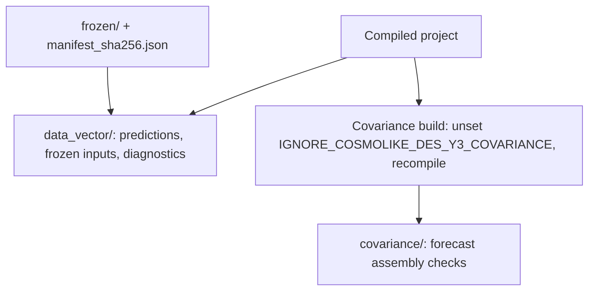
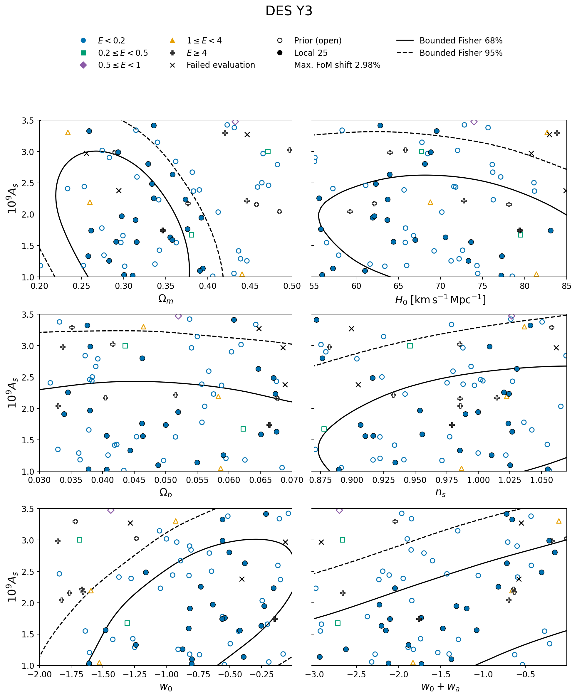

# Tests

The DES Y3 tests and optional studies are organized as follows.

- [Data-vector and likelihood checks](data_vector/README.md) cover the project
  predictions, frozen inputs and numerical diagnostics.
- [Covariance checks](covariance/README.md) cover forecast assembly and its
  documented component checks. Covariance generation must be compiled.
- <a name="optional_studies"></a>[Optional studies](studies/README.md#optional_studies)
  compare n(z) reconstructions and numerical accuracy, with plots and
  $\Delta\chi^2$ results. Run them separately from the routine tests.



The data-vector sector includes the setting-sequence tests
(`data_vector/test_setting_sequences.py`): they change cosmolike
settings in one process, as a notebook does between evaluations, and
compare every result bit for bit with a separate process that saw only
the final settings. A change the loaded data layout cannot follow must
stop with a clear message instead of returning numbers computed from
the earlier settings.

We assume Cocoa and this project are installed, the Cocoa Conda environment
is active, the shell is Bash, and the current folder is `cocoa/Cocoa/`.

Run the sectors in separate Python invocations: they initialize different
compiled-library state. Running one project at a time also avoids importing
another project's same-named test helpers.

**Step :one:**: activate Cocoa.

```bash
source start_cocoa.sh
```

**Step :two:**: run the data-vector sector.

```bash
python -m pytest ./projects/des_y3/tests/data_vector
```

**Step :three:**: enable covariance generation.

```bash
unset IGNORE_COSMOLIKE_DES_Y3_COVARIANCE
```

**Step :four:**: compile the project.

```bash
source ./projects/des_y3/scripts/compile_des_y3.sh
```

**Step :five:**: run the covariance sector.

```bash
python -m pytest ./projects/des_y3/tests/covariance
```

The project must be enabled in `set_installation_options.sh` before
activation. A covariance skip in a deliberately disabled build is expected;
it is not a successful covariance check. Read the sector guide to distinguish
asserted regressions from advisory accuracy reports.

Frozen configurations and inputs are protected by `manifest_sha256.json`.
Do not regenerate references to silence an unexplained failure. The
[data-vector guide](data_vector/README.md#refreeze) documents the deliberate
reference-update procedure and its limits.

Hybrid examples can be checked without sampling:

**Step :one:**: check configuration 1.

```bash
python ./projects/des_y3/EXAMPLE_EMUL2_MINIMIZE1.py --check
```

**Step :two:**: check configuration 2.

```bash
python ./projects/des_y3/EXAMPLE_EMUL2_MINIMIZE2.py --check
```

## Matter-emulator prior comparison <a name="matter_emulator_prior"></a>

[compare_emulator_camb.py](compare_emulator_camb.py) compares the candidate
matter-power emulator with CAMB through this project's existing likelihood.
It uses `EXAMPLE_EVALUATE1.yaml`, draws 50 cosmologies from its cosmological box priors,
restricts $`0.2 < \Omega_m < 0.5`$, and fixes $`\sum m_\nu=0.06`$ eV.
For the broad-prior sample, nuisance parameters stay at the example's
declared evaluation point. Both
calculations use plain `mead2020` and CAMB background distances. The original
example and its production physics are not modified.

The installed emulator code and trained models are used by default. For
separate candidate checkouts, use the following commands from activated
Cocoa. The nonlinear files must exist under `emulmps/w0wa_mead2020/`
in the selected data checkout.

**Step :one:**: select the candidate code checkout.

```bash
export EMULATOR_CODE_DIR=/path/to/emulators_code
```

**Step :two:**: select the candidate model-data checkout.

```bash
export EMULATOR_DATA_DIR=/path/to/emulators_data_lcdm
```

**Step :three:**: choose the OpenMP thread count. The driver keeps BLAS
at one thread and sets TensorFlow before importing the numerical libraries.

```bash
export OMP_NUM_THREADS=4
```

**Step :four:**: run the comparison.

```bash
python projects/des_y3/tests/compare_emulator_camb.py
```

The shared routine is in `cosmolike_core/cocoa_testing.py`, following the
other project tests. Model number $`i`$ uses seed $`137+i`$; `--seed` and
`--models` select another reproducible sample. BLAS remains at one thread.
The test uses the original CAMB likelihood route and the existing EMUL2
route. The selected example disables HOD galaxy spectra and halo-model IA;
its active power-spectrum calculations use total matter. EMUL2 also prepares
an approximate cold-matter table, but these selected observables do not
consume it. This comparison therefore does not validate halo observables,
a cold-matter emulator or a separate distance emulator. The existing
routes can also have different last tabulated wavenumbers and extrapolation
ranges. Their prediction difference measures integration into the project,
including those numerical choices; it does not isolate neural-network error.

The comparison statistic is the squared difference between predictions
weighted by the project's masked precision matrix,
$`\delta m^T C^{-1}\delta m`$. It is not the difference of their fit statistics
against the observations. The requested criterion is strictly below 1. The process exits
with status 1 if any point fails that criterion or cannot be evaluated.
Failed points are retained, never replaced by easier draws; broad-prior
points can lie outside the networks' coordinate ranges.

Results are written to `chains/matter_emulator_prior/EXAMPLE_EVALUATE1/with_fisher/`:
`points.txt`, the two prediction arrays, `precision.npy`, `status.txt`,
`distances.txt`, `likelihood_relevance.txt`, and `summary.txt`. The source
YAML and revision record identify the inputs. The prediction-only
`--no-fisher` mode omits the `with_fisher/` subfolder. Rerunning the same command recomputes the sample and
replaces these generated results. Agreement at these points is useful for
an importance-sampling proposal, but does not establish adequate overlap
or effective sample size for an actual posterior chain.

The default example uses observed DES Y3 cosmic-shear data.
The likelihood-relevance table gives each CAMB fit penalty relative to the
best of the same prior draws, with every nuisance parameter fixed. This
can show that large emulator differences occur away from the better fits
on this slice. It is not a profile-likelihood or marginalized-posterior
exclusion test, and the prior draws are not posterior samples.

### Official hybrid-emulator test and Fisher figure

<!-- hybrid-emulator figure -->
The test draws cosmologies with $w_0>-2$, $1<10^9 A_s\leq 3.5$, $H_0<85$ km/s/Mpc and $0.2<\Omega_m<0.5$, with $m_\nu=0.06$ eV.
The numbered example supplies any tighter priors.
The open symbols show 50 broad draws.
The filled symbols show 25 draws near the example fiducial.
The solid and dashed curves enclose the 68% and 95% regions of the nuisance-marginalized Fisher forecast.
The largest measured FoM change was 2.98% against the 1% target. These contours identify the region used for the focused emulator comparisons.
The official test reads the model settings from [the fixed parameter tables](frozen/emulator_precision/). It evaluates CAMB and the emulator on the same ordered rows each time.
The initial Fisher selected the focused coordinates; recomputing the contours leaves those coordinates fixed.



After a later run completes the focused sample,
copy its `fisher/emulator_fisher.png` to `tests/figures/emulator_precision.png` to refresh the published figure.
<!-- end hybrid-emulator figure -->

The command-line driver can distribute independent cosmologies and Fisher
columns over MPI, following the LSST Y1 × DESI Fisher calculation. For one
project with two ranks and four OpenMP threads per rank, run:

```bash
mpirun -n 2 --bind-to none python -m mpi4py \
  projects/des_y3/tests/compare_emulator_camb.py --mpi --advisory
```

Run one project at a time with this allocation. Each rank owns a separate
model and evaluates different points or derivative columns. OpenMP works
inside each evaluation; BLAS stays at one thread. Rank zero assembles and
writes the combined results. The `--mpi` flag is required: simply launching
the serial driver twice would repeat work and write to the same files.
`python -m mpi4py` also stops the other ranks if an uncaught error terminates
one rank. Plot-only runs use rank zero and need no MPI launch.


The E5 test includes the approved accuracy figure whenever the hybrid
emulator code and networks are installed. No separate plotting flag is
needed. `EMULATOR_CODE_DIR` and `EMULATOR_DATA_DIR` can select candidate
checkouts. This is a long numerical test: it evaluates 50 prior cosmologies
through CAMB and the emulator, computes Fisher derivatives at two step
sizes, then evaluates 25 focused points selected from that bounded Fisher
distribution. It keeps BLAS at one thread.

```bash
python -m pytest projects/des_y3/tests/data_vector/test_emul2.py -k test_e5_hybrid_emulator_fisher
```

Each invocation saves vectors, parameters, provenance, diagnostics and the
PNG/PDF figure in a new directory below `chains/hybrid_emulator_tests/`.
The colors show the direct prediction error
`E = (emulator - CAMB).T @ precision @ (emulator - CAMB)` at thresholds
0.2, 0.5, 1 and 4. Each error interval has its own marker shape; open
markers are prior draws and filled markers are focused points. Failed
calculations use an x marker. The title identifies the project;
the amplitude axis stops at 3.5, or at a tighter project bound. This cap does not establish accuracy throughout the box.

The Fisher calculation uses `EXAMPLE_EVALUATE1.yaml` by default: its
fiducial, probe, sampled cosmological and nuisance parameters, and full
retained data vector. The focused selection follows this project's bounded
Fisher distribution and varies the differentiated nuisance parameters too.
It does not use emulator errors to select easier points. A supplied
`--local-points` named-column table replaces the automatic selection; E5
requires no such file. Both samples appear in the same accuracy figure.

When a weak Fisher direction spans many prior widths, the shared sampler
adapts its Gaussian proposal to the finite bounds. Exact importance weights
remove that extra proposal curvature before calculating marginalized moments.
Independent scrambles check the resulting widths, means and probability mass.

The Fisher calculation includes Gaussian prior curvature and applies hard
bounds before marginalizing the plotted pairs. Solid/dashed contours enclose
68/95 percent of this centered local approximation; they are not measured
posterior contours. Insufficient bounded-sample convergence fails the test.
For ordinary NLA, the globally unused A2 amplitude, A2 redshift slope and
BTA parameters have independent priors that integrate out exactly. They
remain in the Cobaya input point but do not need Fisher derivatives.
Other columns with zero response only at the fiducial remain bounded
directions, without artificial information from rounding identical predictions.

Large prediction errors and individual nonfinite emulator predictions are
reported as advisory results. Missing CAMB references, no valid comparisons,
or an incomplete Fisher/plot calculation fail the test. Frozen regression
references and production theory choices are not changed.

To redraw a completed run, set `EMULATOR_COMPARISON_DIR` to its directory:

```bash
python projects/des_y3/tests/compare_emulator_camb.py --plot-only "$EMULATOR_COMPARISON_DIR"
```

Add `--resample-fisher --fisher-sample-power 20` to repeat only the bounded
integration with more samples. `--no-fisher` is available in the standalone
driver for a prediction-only diagnostic; E5 does not use it. The driver
supports `--models`, `--seed`, `--points` and `--output` for explicit studies.
Its `--advisory` flag is used by E5; without it, accuracy exceedances also
produce a nonzero exit code.

The native accuracy-control regression also checks the historical signed
integration controls in fresh processes. It accepts levels -1, 10 and 62,
and rejects values outside the core's supported range. Level 10 in the
high-accuracy advisory suite is intentional; this guard check does not
establish convergence of a Fisher matrix or a survey covariance.
