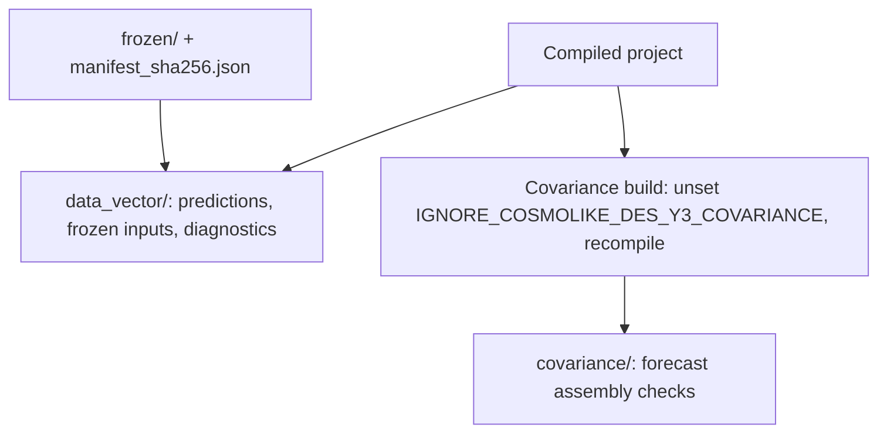

# Tests

The DES Y3 tests and optional studies are organized as follows.

- [Data-vector and likelihood checks](data_vector/README.md) cover the project
  predictions, frozen inputs and numerical diagnostics.
- [Covariance checks](covariance/README.md) cover forecast assembly and its
  documented component checks. Covariance generation must be compiled.
- <a name="optional_studies"></a>[Optional studies](studies/README.md#optional_studies)
  compare n(z) reconstructions and numerical accuracy, with plots and
  $\Delta\chi^2$ results. Run them separately from the routine tests.



The data-vector sector includes the setting-sequence tests
(`data_vector/test_setting_sequences.py`): they change cosmolike
settings in one process, as a notebook does between evaluations, and
compare every result bit for bit with a separate process that saw only
the final settings. A change the loaded data layout cannot follow must
stop with a clear message instead of returning numbers computed from
the earlier settings.

We assume Cocoa and this project are installed, the Cocoa Conda environment
is active, the shell is Bash, and the current folder is `cocoa/Cocoa/`.

Run the sectors in separate Python invocations: they initialize different
compiled-library state. Running one project at a time also avoids importing
another project's same-named test helpers.

**Step :one:**: activate Cocoa.

```bash
source start_cocoa.sh
```

**Step :two:**: run the data-vector sector.

```bash
python -m pytest ./projects/des_y3/tests/data_vector
```

**Step :three:**: enable covariance generation.

```bash
unset IGNORE_COSMOLIKE_DES_Y3_COVARIANCE
```

**Step :four:**: compile the project.

```bash
source ./projects/des_y3/scripts/compile_des_y3.sh
```

**Step :five:**: run the covariance sector.

```bash
python -m pytest ./projects/des_y3/tests/covariance
```

The project must be enabled in `set_installation_options.sh` before
activation. A covariance skip in a deliberately disabled build is expected;
it is not a successful covariance check. Read the sector guide to distinguish
asserted regressions from advisory accuracy reports.

Frozen configurations and inputs are protected by `manifest_sha256.json`.
Do not regenerate references to silence an unexplained failure. The
[data-vector guide](data_vector/README.md#refreeze) documents the deliberate
reference-update procedure and its limits.

Hybrid examples can be checked without sampling:

**Step :one:**: check configuration 1.

```bash
python ./projects/des_y3/EXAMPLE_EMUL2_MINIMIZE1.py --check
```

**Step :two:**: check configuration 2.

```bash
python ./projects/des_y3/EXAMPLE_EMUL2_MINIMIZE2.py --check
```

## Matter-emulator prior comparison <a name="matter_emulator_prior"></a>

[compare_emulator_camb.py](compare_emulator_camb.py) compares the candidate
matter-power emulator with CAMB through this project's existing likelihood.
It uses `EXAMPLE_EVALUATE2.yaml`, draws 50 cosmologies from its cosmological box priors,
restricts $`0.2 < \Omega_m < 0.5`$, and fixes $`\sum m_\nu=0.06`$ eV.
Nuisance parameters stay at the example's declared evaluation point. Both
calculations use plain `mead2020` and CAMB background distances. The original
example and its production physics are not modified.

Select candidate code and trained-model checkouts before the run. The new
nonlinear files must exist under the data checkout's `emulmps/w0wa_mead2020/`.
Each command runs from activated Cocoa.

**Step :one:**: select the candidate code checkout.

```bash
export EMULATOR_CODE_DIR=/path/to/emulators_code
```

**Step :two:**: select the candidate model-data checkout.

```bash
export EMULATOR_DATA_DIR=/path/to/emulators_data_lcdm
```

**Step :three:**: choose the OpenMP thread count. The driver keeps BLAS
at one thread and sets TensorFlow before importing the numerical libraries.

```bash
export OMP_NUM_THREADS=4
```

**Step :four:**: run the comparison.

```bash
python projects/des_y3/tests/compare_emulator_camb.py
```

The shared routine is in `cosmolike_core/cocoa_testing.py`, following the
other project tests. Model number $`i`$ uses seed $`137+i`$; `--seed` and
`--models` select another reproducible sample. BLAS remains at one thread.
The test uses the original CAMB likelihood route and the existing EMUL2
route. The selected example disables HOD galaxy spectra and halo-model IA;
its active power-spectrum calculations use total matter. EMUL2 also prepares
an approximate cold-matter table, but these selected observables do not
consume it. This comparison therefore does not validate halo observables,
a cold-matter emulator or a separate distance emulator. The existing
routes can also have different last tabulated wavenumbers and extrapolation
ranges. Their prediction difference measures integration into the project,
including those numerical choices; it does not isolate neural-network error.

The comparison statistic is the squared difference between predictions
weighted by the project's masked precision matrix,
$`\delta m^T C^{-1}\delta m`$. It is not the difference of their fit statistics
against the observations. The requested criterion is strictly below 1. The process exits
with status 1 if any point fails that criterion or cannot be evaluated.
Failed points are retained, never replaced by easier draws; broad-prior
points can lie outside the networks' coordinate ranges.

Results are written to `chains/matter_emulator_prior/EXAMPLE_EVALUATE2/`:
`points.txt`, the two prediction arrays, `precision.npy`, `status.txt`,
`distances.txt`, and `summary.txt`. The source YAML and revision record
identify the inputs. Rerunning the same command recomputes the sample and
replaces these generated results. Agreement at these points is useful for
an importance-sampling proposal, but does not establish adequate overlap
or effective sample size for an actual posterior chain.
