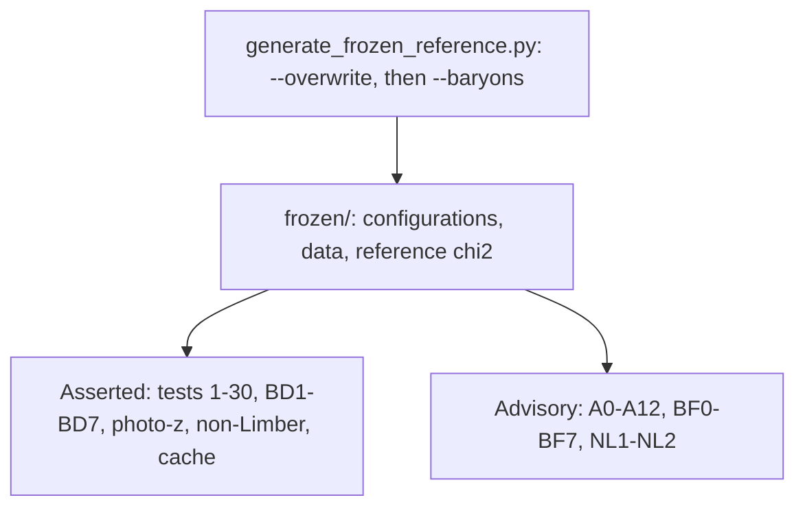
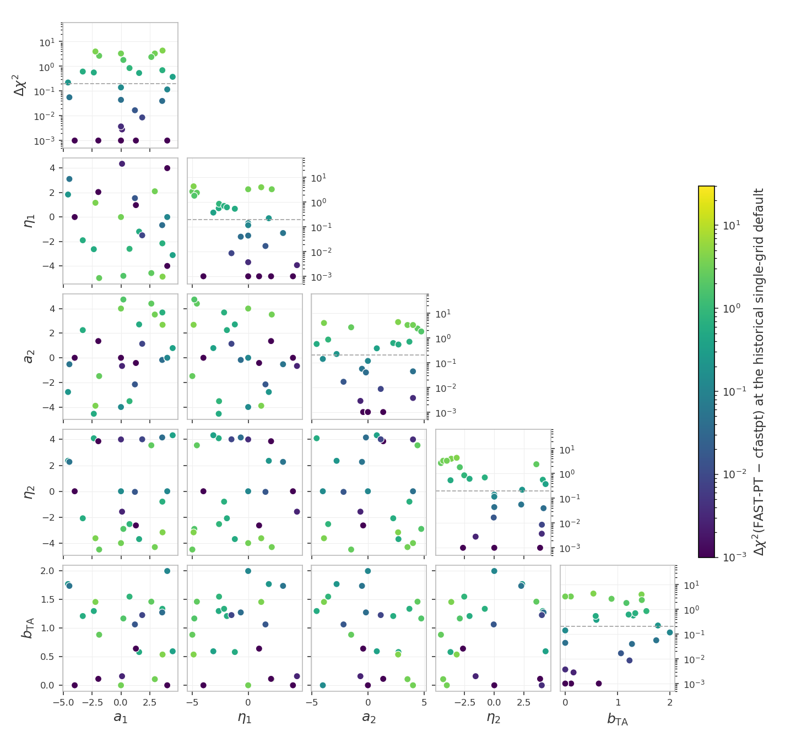
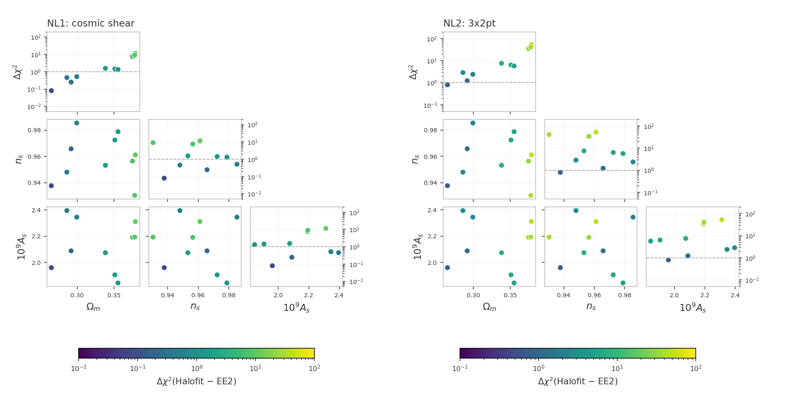
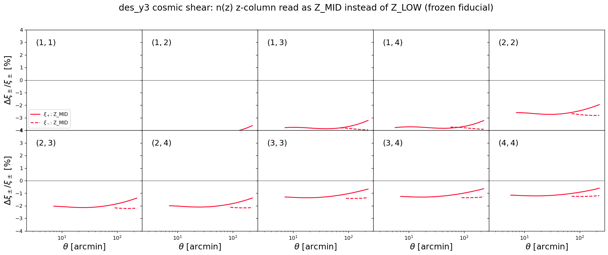
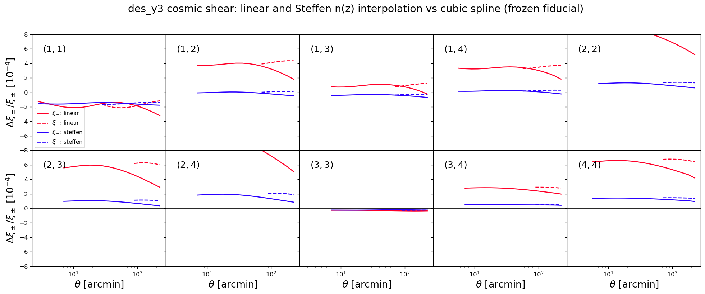
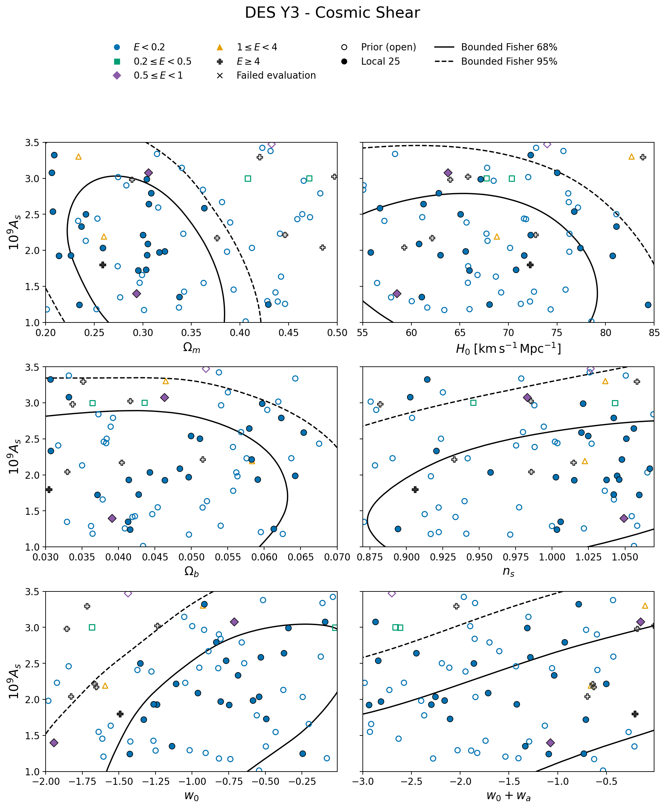
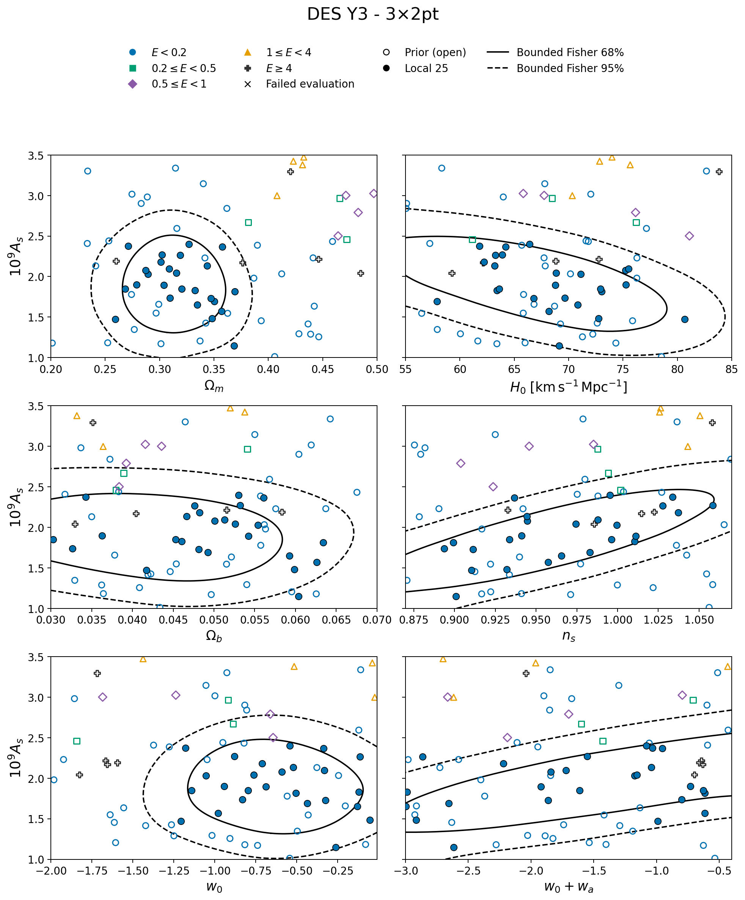

# Unit tests for the likelihoods

The frozen snapshot `frozen/` and its manifest `manifest_sha256.json`
live in the parent `tests/` directory; the paths below are relative to
it.

These tests catch two kinds of silent breakage: a $\chi^2$ that drifted
because code or data changed by accident, and a race condition (a bug
where evaluating several points in a row corrupts a later result
through leftover internal state or colliding OpenMP threads).

The project ships two generations of DES data, and the tests cover
both: tests 1-8, 11-14 and 27-30 run on the DES-Y3 data set
(`des_y3_real.dataset`), tests 15-26 on the DES-Y1 data set
(`des_y1_real.dataset`), through the same `des_y3.*` likelihood
classes. Each uses its data set's covariance, mask and n(z) with a
synthetic data vector ([Appendix](#frozen_copy)). Numbers 9 and
10 are unused.

Most checks build each model in its own worker subprocess: the Y1 and
Y3 data sets have different masked dimensions and n(z) table lengths,
and the cosmolike C layer aborts the whole process when a second
configuration with different dimensions initializes after the first.
The photo-z, non-Limber and cache checks build their models in the
pytest process itself. The isolation is internal; the commands below
stay the same.

The mechanism of every shared check family - the frozen-reference and
race contract, the zero-baseline construction, the sweeps and their
`--high`/`--mask` options, the accuracy settings and their meanings -
is documented once in
[the shared data-vector checks](https://github.com/CosmoLike/cocoa-cosmolike-core/blob/main/README.md#dv_checks)
of the CosmoLike core. This file records what des_y3 runs and what it
measured.

# Table of contents

1. [Running the tests](#run_tests)
2. [The tests](#the_tests)
    1. [The CFASTPT vs FASTPT comparison](#cfastpt_fastpt)
    2. [The Halofit vs EE2 checks](#halofit_ee2)
    3. [The EE2 race test](#ee2_race)
    4. [Accuracy checks](#accuracy_checks)
    5. [Baryonic feedback checks](#baryon_checks)
    6. [The photo-z convention checks](#photoz_conventions)
    7. [The non-Limber checks](#nonlimber_checks)
    8. [The sector-ladder cache check](#cache_ladder)
    9. [The non-Limber early-exit tolerance checks](#nonlimber_tolerance)
3. [Hybrid-emulator accuracy test](#hybrid-emulator-accuracy-test)
4. [FoM convergence](#fom-convergence)
5. [Appendix](#appendix)
    1. [FAQ: What does this project's snapshot hold?](#frozen_copy)
    2. [FAQ: Why does the non-Limber clustering subtract a separable-growth term?](#gg_growth_fix)
    3. [FAQ: How can maintainers refresh the snapshot?](#refreeze)

## Running the tests <a name="run_tests"></a>

We assume users are in the Conda cocoa environment from a previous
`conda activate cocoa` command, that the shell is bash, and that the
current folder is the cocoa main folder `cocoa/Cocoa`. Every command
below assumes `start_cocoa.sh` has been sourced once:

    source start_cocoa.sh

Run the full suite with

    python -m pytest ./projects/des_y3/tests/data_vector

or, without pytest,

    python -m unittest discover -s ./projects/des_y3/tests/data_vector -v

Under unittest the `--high` and `--mask` options below do not exist;
the FAST-PT and Halofit vs EE2 checks then run at their defaults
unless `COCOA_FASTPT_HIGH` and `COCOA_FASTPT_MASK` are exported.

The tests change no project files. Each test prints a progress line per
model build and per evaluation, then a report with the computed $\chi^2$,
the stored reference, the difference, and the pass limit. A full run
performs about 600 likelihood evaluations; the high-accuracy checks alone
take minutes each. The test files set their OpenMP worker count before
imports.

The shared likelihood tests default to four OpenMP workers. For six workers,
set `COCOA_TEST_OMP_THREADS=6` and `OMP_THREAD_LIMIT=6` before
starting Python. The entry points copy the test setting to
`OMP_NUM_THREADS` before importing native libraries. Keep BLAS at
one worker. A smaller OpenMP thread limit can reduce the actual team
below the requested count.

## The tests <a name="the_tests"></a>

The standard configurations get four tests each - the frozen-reference
drift check and the race check, in NLA and in TATT
([mechanism](https://github.com/CosmoLike/cocoa-cosmolike-core/blob/main/README.md#dv_frozen)).
The TATT variants set

    IA_model: 1
    DES_A2_1: 0.05
    DES_BTA_1: 0.05
    DES_A2_2: -1.51541

The checks split into asserted regressions, which fail when a number
moves, and advisory reports, which print numbers without pass/fail:



The suite follows the shared
[test-file naming convention](https://github.com/CosmoLike/cocoa-cosmolike-core/blob/main/README.md#dv_naming): a file name
means the same thing in every project. This project's
configurations and test numbers:

| file | data | configuration | tests |
|---|---|---|---|
| `test_example1.py` | DES-Y3 | cosmic shear | 1-4 |
| `test_example2.py` | DES-Y3 | 3x2pt | 5-8 |
| `test_example2_2x2pt.py` | DES-Y3 | 2x2pt (`des_y3.combo_2x2pt`) | 11-14 |
| `test_example3.py` | DES-Y1 | cosmic shear | 15-18 |
| `test_example4.py` | DES-Y1 | 3x2pt | 19-22 |
| `test_example4_2x2pt.py` | DES-Y1 | 2x2pt (`des_y3.combo_2x2pt`) | 23-26 |
| `test_fastpt.py` | DES-Y3 | the sweep: shear; 3x2pt (`des_y3.combo_3x2pt`); 2x2pt (`des_y3.combo_2x2pt`) | 27, 28, 29 |
| `test_ee2.py` | DES-Y3 | race | 30 |

Tests 9 and 10 are not used: the numbering follows the shared
convention, where they are the frozen FAST-PT reference checks
this project does not ship.

### The CFASTPT vs FASTPT comparison (`test_fastpt.py`, tests 27-29) <a name="cfastpt_fastpt"></a>

The sweep mechanism, the zero-baseline construction and the
`--high`/`--mask` options are in
[the shared checks](https://github.com/CosmoLike/cocoa-cosmolike-core/blob/main/README.md#dv_fastpt);
here the internal FFTLog grid holds 1,100 points, plus 200 per unit
of `internal_accuracyboost` above 1. Test 27 runs the sweep on cosmic
shear, test 28 on the 3x2pt likelihood (`des_y3.combo_3x2pt`) and
test 29 on the 2x2pt likelihood (`des_y3.combo_2x2pt`). In test 28
the frozen configuration fixes the one-loop bias amplitudes
(`DES_B2_*`) at zero, so the sweep scores the intrinsic-alignment
tables alone on the wider data vector; in test 29 clustering carries
no intrinsic alignment, so the TATT tables are scored through
galaxy-galaxy lensing alone.

The masks `--mask` accepts here (it also reruns the Halofit vs EE2
checks NL1-NL2): `frozen` (the default) keeps the baseline mask of
the frozen contract (533 of the 900 data points); `ones` keeps every
point (no scale cuts), the strictest comparison.

> [!NOTE]
> With one shared grid and no upsampling (the first row of the table
> below), the difference reaches $\Delta\chi^2 = 4.3$ across the prior.

The point values, the design, and the decision record live with the
lsst_y1 project (its tests/README.md carries the full discussion);
the table below is this project's own measurement:

| output table (points) | internal grid (points) | max $\Delta\chi^2$ | Runtime / first row |
|---|---|---|---|
| 1,100 | 1,100 (shared) | 4.32 | 1.00 |
| 1,024,900 (`accuracyboost: 1`, the default) | 1,100 (the default) | 0.000948 | 1.40 |
| 2,048,900 (`accuracyboost: 2`) | 1,300 (`internal_accuracyboost: 2`) | 0.000892 | 1.60 |

Runtime ratios use the first row of this table as the baseline, with the
same timed scope and machine. They compare sampling costs within this
project; absolute runtimes depend on the machine.



Measured:

- Test 28 (3x2pt): max $\Delta\chi^2 = 0.0010$ at the defaults,
  $0.000013$ at the pushed camb/cosmolike settings.
- Test 29 (2x2pt): $0.00010$ and $0.000001$, the mildest of the
  three, with the TATT tables entering through galaxy-galaxy
  lensing alone.
- `--mask=ones` (no scale cuts, all 900 points weighted): every
  sweep still passes. Cosmic shear measures max
  $\Delta\chi^2 = 0.055$ at the default camb/cosmolike settings,
  3x2pt 0.062, and 2x2pt 0.011; at the pushed settings they fall
  to 0.00004, 0.00006, and 0.00003.

The default-settings values are insensitive to the FAST-PT boosts
(cosmic shear's 0.055 is fifty-seven times its baseline-mask
value): the unmasked small scales amplify cosmolike's default
integration error, not a FAST-PT grid deficiency.

> [!NOTE]
> The fastpt defaults hold this accuracy on their own; raising the
> boosts is a convergence test, not a need. cfastpt (`IA_code: 0`)
> remains the reference implementation.

Run the comparison at the default and at the pushed camb/cosmolike
settings (the full comparison is both invocations):

    python -m pytest ./projects/des_y3/tests/data_vector/test_fastpt.py
    python -m pytest ./projects/des_y3/tests/data_vector/test_fastpt.py --high=1

### The Halofit vs EE2 checks (`test_nonlinear.py`, NL1-NL2) <a name="halofit_ee2"></a>

[Mechanism](https://github.com/CosmoLike/cocoa-cosmolike-core/blob/main/README.md#dv_halofit_ee2):
NL1 evaluates the DES-Y3 cosmic-shear data vector and NL2 the DES-Y3
3x2pt one, in the NLA configuration, with both nonlinear-power
sources at the ten shared cosmologies (halofit, `non_linear_emul: 2`,
is the frozen contract's setting). Measured (the figure below, frozen
mask):

- NL1 (cosmic shear): max $\Delta\chi^2 = 11.5$, median $1.4$;
  max $21.5$, median $2.4$ under `--mask=ones`.
- NL2 (3x2pt): max $53.0$, median $6.0$; max $243.0$, median
  $42.6$ under `--mask=ones`.



Run them under the frozen contract mask and with every data point
kept:

    python -m pytest ./projects/des_y3/tests/data_vector/test_nonlinear.py
    python -m pytest ./projects/des_y3/tests/data_vector/test_nonlinear.py --mask=ones

### The EE2 race test (`test_ee2.py`, test 30) <a name="ee2_race"></a>

[Mechanism](https://github.com/CosmoLike/cocoa-cosmolike-core/blob/main/README.md#dv_ee2):
the gate that compiles the pre-modification EuclidEmulator2 build and
compares the two builds' data vectors runs as the lsst_y1 project's
test 18 and is not repeated here. Test 30 is the race check with EE2
on, on the DES-Y3 cosmic-shear configuration (`non_linear_emul: 1`);
every other race check in the table runs with halofit
(`non_linear_emul: 2`, the frozen contract's setting), so only this
row executes EE2's OpenMP-threaded compute. Measured:

- Test 30: the fresh and 10th-in-a-row fiducial agree to all eight
  printed decimals.
- The modified EE2 build against the unmodified EuclidEmulator2, at ten
  fixed cosmologies on this project's cosmic shear under the frozen
  mask: max $\Delta\chi^2 = 3.0\times10^{-8}$, with a max
  fractional data-vector difference of $7.4\times10^{-6}$.

### Accuracy checks (`test_accuracy.py`, A0-A12) <a name="accuracy_checks"></a>

[Mechanism, setting meanings and cost order](https://github.com/CosmoLike/cocoa-cosmolike-core/blob/main/README.md#dv_accuracy):
check A0, which runs first, changes one accuracy parameter at a time
on the DES-Y3 3x2pt NLA configuration, so a large $\Delta\chi^2$ can
be attributed to the parameter causing it; A1-A12 re-evaluate cosmic
shear, 3x2pt and 2x2pt, in NLA and TATT, on the DES-Y3 data (A1-A6)
and on the DES-Y1 data (A7-A12), with every setting pushed at once.
This project's pushed values:

| setting | raised to |
|---------|-----------|
| `accuracyboost` (cosmolike) | 3 (A0 also tries 5) |
| `integration_accuracy` (cosmolike) | 10 |
| `internal_accuracyboost` (cosmolike) | 2 |
| `lmax` (cosmolike) | 200000 |
| `kmax_boltzmann` (cosmolike) | 40 |
| `AccuracyBoost` (CAMB) | 2 |
| `k_per_logint` (CAMB) | 50 |
| `kmax` (CAMB) | 50 |

The nested-grid construction `accuracyboost` refines is commented in
`likelihood/_cosmolike_prototype_base.py`. This project's
`internal_accuracyboost` default, 1.0, keeps the convolution grid
equal to the output table: the exact single-grid path. The lsst_y1
scan measured $\Delta^T C^{-1} \Delta \le 10^{-9}$ against that path
for grid fractions down to 0.27.

Run them on their own, or skip them (high-accuracy evaluations take
minutes):

    python -m pytest ./projects/des_y3/tests/data_vector/test_accuracy.py
    python -m pytest ./projects/des_y3/tests/data_vector --ignore ./projects/des_y3/tests/data_vector/test_accuracy.py

### Baryonic feedback checks (`test_accuracy_baryons.py`, BF1-BF7; `test_baryons.py`, BD1-BD7) <a name="baryon_checks"></a>

[Mechanism](https://github.com/CosmoLike/cocoa-cosmolike-core/blob/main/README.md#dv_baryons):
the accuracy checks (BF) report the default-versus-pushed
$\Delta\chi^2$ with each feedback method on, one advisory check per
method; check BF0 additionally runs the one-setting-at-a-time scan
with the Akino SP(k) feedback on, so a large delta names the setting
causing it. The drift tests (BD) pin each method's frozen prediction
(`generate_frozen_reference.py --baryons`), one test per method.

Every checked configuration is measurable by construction: the
BACCOemu check evaluates with `omegab: 0.049`, inside that emulator's
baryon-density training box, whose floor sits exactly above the
fiducial `omegab: 0.04`; and the double-power-law point is chosen to
keep the baryon fraction inside SP(k)'s calibrated band over the full
redshift grid.

Run them with

    python -m pytest ./projects/des_y3/tests/data_vector/test_accuracy_baryons.py
    python -m pytest ./projects/des_y3/tests/data_vector/test_baryons.py

### The photo-z convention checks (`test_photoz_conventions.py`) <a name="photoz_conventions"></a>

[Mechanism](https://github.com/CosmoLike/cocoa-cosmolike-core/blob/main/README.md#dv_photoz):
the frozen cosmic-shear fiducial under the default, each alternative
convention, and the default again. `scripts/README.md` lists the DES
FITS files the n(z) tables come from and how to write the tables with
either z column. Measured:

- default: the test requires the frozen reference of the cosmic-shear
  NLA configuration, $\chi^2 = 0.000103$.
- linear: $\Delta\chi^2 = 3.1\times10^{-4}$; Steffen:
  $\Delta\chi^2 = 1.6\times10^{-5}$. Either interpolant change is far below
  the survey's statistical precision.
- Z_MID: $\Delta\chi^2 = 0.30$ - the half-bin z-column reading
  is the one photo-z convention that matters at this precision.

The figures below are regenerated by
`generate_photoz_convention_figure.py`:





### The non-Limber checks (`test_nonlimber_ggl.py`, `test_nonlimber_gg.py`) <a name="nonlimber_checks"></a>

[Mechanism](https://github.com/CosmoLike/cocoa-cosmolike-core/blob/main/README.md#dv_nonlimber):
in this project galaxy-galaxy lensing defaults to Limber
(`adopt_limber_gs: 1`) because its lensing kernel is broad and the
measured difference below is far below the survey's statistical
precision, while galaxy clustering defaults to the exact projection
below $\ell = 150$ (`adopt_limber_gg: 0`): the narrow lens
distributions make the Limber approximation fail at low $\ell$ for
the clustering auto spectra.

Galaxy-galaxy lensing, measured:

- $\Delta\chi^2 = 0.012$ for the Y3 3x2pt data vector (example2),
  far below the survey's statistical precision; the largest pairs,
  (3,2) and (4,2), contribute 0.007 and 0.006. The test pins
  $\Delta\chi^2 = 0.01204$ to 5%.

Across the examples' prior box ($\Omega_m$ in $[0.2, 0.5]$,
$w_0 + w_a$ in $[-3, -0.01]$; 25 drawn and 5 held models, seed base
137) with the examples' amplitude cut, which keeps the ratio
$(A_s/A_s^{\rm fid})(b_i/b_i^{\rm fid})^2 \le 8$ over the sampled
lens bins, the Limber choice holds at every held model (maximum
$\Delta\chi^2 = 0.152$ at the production cap 150) but not at every
drawn one: 10 of 25 drawn models are at or above 0.2, with a maximum
of $\Delta\chi^2 = 0.842$. The drawn models above 0.2 carry large NLA
amplitudes or redshift powers (`DES_A1_1`, `DES_A1_2`, flat in
$[-5, 5]$, reaching 4.8 in magnitude) and are accepted: the
galaxy-shear intrinsic-alignment (GI) term carries a Limber error 2 to
3 times the clustering one, because the intrinsic shear follows the
tidal field, and it grows with the IA amplitudes while the covariance
stays fiducial.

Galaxy clustering, measured:

- $\Delta\chi^2 = 9.26$ for the Y3 3x2pt data vector (example2), against
  0.012 for the same comparison in galaxy-galaxy lensing. The test pins
  $\Delta\chi^2 = 9.262$ to 5%.
- Lens bins 4, 3, 2, 1, 0 contribute 4.56, 2.44, 1.75, 0.61, 0.19
  (each bin's block alone).

### The sector-ladder cache check (`test_cache_consistency.py`) <a name="cache_ladder"></a>

The deterministic mixed-update ladder and its bitwise assertions are
described in
[the shared checks](https://github.com/CosmoLike/cocoa-cosmolike-core/blob/main/README.md#dv_cache_ladder).
This project's ladder takes three steps in each sector in turn
(cosmology, intrinsic alignment, source photo-z, lens photo-z and
shear calibration), requires every step to change the data vector,
and the final scramble includes galaxy bias.

### The non-Limber early-exit tolerance checks (`test_nonlimber_tolerance.py`) <a name="nonlimber_tolerance"></a>

The non-Limber $C_\ell$ of $w(\theta)$ (and of $\gamma_t$ where
`adopt_limber_gs: 0`) are computed in blocks of 16 multipoles, and a
lens bin (clustering) or lens-source pair (lensing) whose $C_\ell$
agrees with the Limber $C_\ell$ within a tolerance at the end of a
block takes the Limber values from there: the early exit. The switch
multipole is an integer that moves with the parameters, so a
finite-difference derivative whose stencil straddles a switch sees a
step in the model, which a Fisher matrix reads as information. The
likelihood keys `nonlimber_tolerance_gg: 0.002` and
`nonlimber_tolerance_gs: 0.01` set the tolerances; `0` removes the
exit, the setting Fisher derivatives use, and `accuracyboost` $> 1$
divides the tolerances in use by $1 + 2\,(\mathrm{boost} - 1)$. The
Fourier data vectors (`C_gg_tomo_ells`, `C_gs_tomo_ells`) never take
the exit.

This project keeps the early exit at the core defaults in production:
at the fiducial it moves the vector by $\delta^T C^{-1} \delta$ =
2.04e-4, far below the 0.2 band. Fisher derivatives and stencil-noise
measurements run with both tolerances at 0, because the switch
multipole puts steps into finite-difference derivatives (the $w_0$
column below drops from 1.74e-3 to 1.93e-4); the derivative helpers of
`cosmolike_notebook_utils/fisher.py` switch the exit off for each
evaluation and restore the yaml values afterwards.

Production also keeps the core default cap `lmax_nonlimber: 150`:
across the examples' prior box with the amplitude cut, cap 150 agrees
with cap 200 at every drawn and held model (drawn maximum
$\Delta\chi^2 = 0.116$, in $w(\theta)$; held maximum 0.0124).

`test_nonlimber_tolerance.py` builds the `example2` (3x2pt, NLA) model
once and runs the shared checks of `nonlimber_tolerance_suite`
(`cosmolike_core/cocoa_testing_suites.py`): the frozen $\chi^2$, the
documented defaults and a bit-for-bit tolerance round trip (tests 1-2);
tolerance 0 moves only $\gamma_t$ and $w(\theta)$, and by a bounded
$\delta^T C^{-1} \delta$ (test 3); the stencil noise of the $w_0$, $w_a$
and `DES_B1_5` derivative columns with and without the early exit (test
4); the FKEM hand-off at the caps `lmax_nonlimber` = 150 and 200
(test 5: a step at the hand-off would raise the noise at the lower cap,
where the FKEM-Limber difference is largest); the low-rank (SVD) engine
next to FKEM at caps 150 and 200, with the galaxy-shear cap matched
between the engines in each pair (test 6); that a negative or nonfinite
tolerance is refused (test 7); the accuracy-boost scaling of the
tolerances in use (test 8); and that the production state returns bit
for bit (test 9). The noise is $\sigma$ of `get_stencil_noise`
(`cosmolike_notebook_utils/fisher.py`): the whitened fourth difference
of five evaluations spaced $h = 0.025$ apart, in $\sqrt{\chi^2}$ units,
the jitter one evaluation adds to a derivative column.

Measured on 2026-11-18 (OMP 4), $\sigma$ in $\sqrt{\chi^2}$ units:

| stencil noise $\sigma$ | $w_0$ | $w_a$ | `DES_B1_5` |
|---|---|---|---|
| default tolerances, cap 150 (production) | 1.74e-3 | 1.48e-4 | 1.41e-3 |
| tolerance 0, cap 150 | 1.93e-4 | 1.48e-4 | 3e-12 |
| tolerance 0, cap 200 | 2.08e-4 | 1.49e-4 | - |

$\gamma_t$ is Limber here (`adopt_limber_gs: 1`), so only the
clustering tolerance acts. Turning the exit off moves the fiducial
vector by $\delta^T C^{-1} \delta$ = 2.04e-4 ($w(\theta)$ only;
test 3 bound 5e-4). The largest
$|C_\ell^{\rm FKEM}/C_\ell^{\rm Limber} - 1|$ over the lens bins
is 8.8e-4 / 9.4e-4 at $\ell$ = 149 / 199. Test 4 bounds every
tolerance-0 column by 2e-3; test 5 allows cap 150 at most 1.1 times
cap 200; test 6 allows the SVD noise at most 1.4 times FKEM with the
galaxy-shear cap matched (measured in $w_0$: at most 1.03 times FKEM
at cap 150 and 1.19 times at cap 200).

Run it alone with

    python -m pytest ./projects/des_y3/tests/data_vector/test_nonlimber_tolerance.py -s

## Hybrid-emulator accuracy test <a name="matter_emulator_prior"></a>

[compare_emulator_camb.py](../compare_emulator_camb.py) compares the candidate
matter-power emulator with CAMB through this project's existing likelihood.
It reads the fixed [benchmark](../fisher_reference/) and its 50 broad and
25 focused cosmologies,
restricts $`0.2 < \Omega_m < 0.5`$, and fixes $`\sum m_\nu=0.06`$ eV.
For the broad-prior sample, nuisance parameters stay at the example's
declared evaluation point. Both
calculations use plain `mead2020` and CAMB background distances. The original
example and its production physics are not modified.

The installed emulator code and trained models are used by default. For
separate candidate checkouts, use the following commands from activated
Cocoa. The nonlinear files must exist under `emulmps/w0wa_mead2020/`
in the selected data checkout.

**Step :one:**: select the candidate code checkout.

```bash
export EMULATOR_CODE_DIR=/path/to/emulators_code
```

**Step :two:**: select the candidate model-data checkout.

```bash
export EMULATOR_DATA_DIR=/path/to/emulators_data_lcdm
```

**Step :three:**: choose the OpenMP thread count. The driver keeps BLAS
at one thread and sets TensorFlow before importing the numerical libraries.

```bash
export OMP_NUM_THREADS=4
```

**Step :four:**: run the comparison.

```bash
python projects/des_y3/tests/compare_emulator_camb.py
```

The shared routine is in `cosmolike_core/cocoa_testing.py`, following the
other project tests. A custom research draw uses seed $`137+i`$ for row
$`i`$. Use `--seed` and `--models` to request a new draw. BLAS remains at one thread.
The test uses the original CAMB likelihood route and the existing EMUL2
route. The selected example disables HOD galaxy spectra and halo-model IA;
its active power-spectrum calculations use total matter. EMUL2 also prepares
an approximate cold-matter table, but these selected observables do not
consume it. This comparison therefore does not validate halo observables,
a cold-matter emulator or a separate distance emulator. The existing
routes can also have different last tabulated wavenumbers and extrapolation
ranges. Their prediction difference measures integration into the project,
including those numerical choices; it does not isolate neural-network error.

The comparison statistic is the squared difference between predictions
weighted by the project's masked precision matrix,
$`\delta m^T C^{-1}\delta m`$. It is not the difference of their fit statistics
against the observations. The requested criterion is strictly below 1. The process exits
with status 1 if any point fails that criterion or cannot be evaluated.
Failed points are retained, never replaced by easier draws; broad-prior
points can lie outside the networks' coordinate ranges.

The driver writes these files under a new `chains/matter_emulator_points/` run directory.
`points.txt`, the two prediction arrays, `precision.npy`, `status.txt`,
`distances.txt`, `likelihood_relevance.txt`, and `summary.txt`. The source
YAML, effective reference YAML and provenance identify the inputs.
An explicit output directory resumes the same comparison checkpoints. Agreement at these points is useful for
an importance-sampling proposal, but does not establish adequate overlap
or effective sample size for an actual posterior chain.

The default example uses observed DES Y3 cosmic-shear data.
The likelihood-relevance table gives each CAMB fit penalty relative to the
best of the same prior draws, with every nuisance parameter fixed. This
can show that large emulator differences occur away from the better fits
on this slice. It is not a profile-likelihood or marginalized-posterior
exclusion test, and the prior draws are not posterior samples.

<!-- hybrid-emulator figure -->
**Emulator training range**

| Parameter | Range |
| --- | --- |
| Total matter density | $0.2<\Omega_m<0.5$ |
| Primordial amplitude | $1<10^9 A_s\le 3.5$ |
| Hubble constant | $H_0<85$ km/s/Mpc |
| Present dark-energy equation of state in CPL | $w_0>-2$ |
| Physical baryon density | $\Omega_b(H_0/100)^2<0.035$ |

The fixed tables intersect this range with the benchmark priors. CAMB uses
one massive species with $\sum m_\nu=0.06$ eV. Both model routes evaluate
the same 50 broad points (open symbols) and 25 focused points (filled symbols).
The solid and dashed curves show the saved 68% and 95%
nuisance-marginalized Fisher regions.

CAMB uses `AccuracyBoost: 1.0`, `k_per_logint: 10` and `kmax: 5`.



Counts use the thresholds 0.2, 0.5, 1 and 4 in that order.

| Case | Broad below threshold (50) | Focused below threshold (25) | Nonfinite broad/focused |
| --- | --- | --- | --- |
| DES Y3 | 39/41/42/44 | 22/22/24/24 | 0/0 |

<!-- end hybrid-emulator figure -->

### Full 3×2pt

The [3×2pt benchmark](../fisher_reference/3x2pt/) uses Evaluate 2's full
optical selection and fixed nuisance values. Its matched Fisher forecast
uses the same retained data vector and marginalizes over the sampled
nuisance parameters. The 50 broad cosmologies are the same as in the
shear comparison. The 25 focused cosmologies come from the 3×2pt Fisher
distribution.

CAMB uses `AccuracyBoost: 1.0`, `k_per_logint: 10`, and `kmax: 5`.



Counts use the thresholds 0.2, 0.5, 1 and 4 in that order.

| Probe | Broad below threshold (50) | Focused below threshold (25) | Nonfinite broad/focused |
| --- | --- | --- | --- |
| 3×2pt | 32/35/38/42 | 22/22/22/23 | 0/0 |

Add `--probe 3x2pt` to the standalone comparison command below.


E5 reads the saved `benchmark.yaml` in [fisher_reference/](../fisher_reference/).
The benchmark fixes the likelihood, data selection, sampled parameters,
fiducial and normal numerical controls.

The accuracy test evaluates CAMB and the candidate at the fixed
[50 broad and 25 focused points](../fisher_reference/) and stores both
vectors, the covariance-weighted error, and point status. Nuisance inputs are
held at the evaluate fiducial. Missing CAMB predictions or a comparison
with no valid vectors fails E5. The E5 adapter treats large prediction errors
as advisory. The strict standalone command also checks the error threshold.

```bash
python -m pytest projects/des_y3/tests/data_vector/test_emul2.py -k e5
```

To distribute the numerical comparisons across two MPI ranks with four
OpenMP threads each, use the same driver directly from activated Cocoa.
Keep BLAS at one thread and pass `--mpi` so the ranks own different points.

```bash
OMP_NUM_THREADS=4 OPENBLAS_NUM_THREADS=1 MKL_NUM_THREADS=1 \
  VECLIB_MAXIMUM_THREADS=1 mpirun -n 2 --bind-to none python -m mpi4py \
  projects/des_y3/tests/compare_emulator_camb.py --mpi --advisory
```

The shared plot uses saved 68% and 95% bounded Fisher contours with
nuisance parameters marginalized. The reference records the matrix, priors,
fiducial and data selection. Use `--fisher-reference` to select a saved
reference directory or `--no-fisher` to show only the comparison points.
Use `EMULATOR_CODE_DIR` and `EMULATOR_DATA_DIR` to select the candidate
network installation.

```bash
python projects/des_y3/tests/compare_emulator_camb.py --plot-only /path/to/run
```

## FoM convergence

This CAMB test uses the ordinary accuracy and physical prescription of each
benchmark to build one full local Fisher matrix. The figure of merit is
$1/\sqrt{\det C_{w_0,w_a}}$, with nuisance parameters marginalized in the
Gaussian approximation. The sampled pair $w_0,w_0+w_a$ has the same ellipse
area. Gaussian prior curvature enters the Fisher matrix, and prior bounds
limit the stencil positions.

The five-point stencil uses a fixed 2.5% relative step, shortened near prior
bounds. A zero-centered parameter uses its specified absolute step or one
tenth of its proposal width. The fourth differences rank the numerical
sensitivity of the columns. Both higher settings reevaluate the same selected
columns and use the same full ordinary Fisher weights. The table scales the
ordinary FoM by the estimated change at each setting. Contributions from
omitted columns and correlated numerical errors remain unknown.

| Case | Setting | CosmoLike boost / integration | CAMB boost / k_per_logint | Approx. FoM | Change from previous |
| --- | --- | --- | --- | --- | --- |
| Cosmic shear | Ordinary | 1.0 / 1 | 1.0 / 10 | 0.029609289 | — |
| Cosmic shear | Refined | 2.0 / 2 | 2.0 / 50 | 0.029596738 | -0.0423899% |
| Cosmic shear | Confirmation | 3.0 / 3 | 3.0 / 75 | 0.029596681 | -0.000192864% |
| 3×2pt | Ordinary | 1.0 / 0 | 1.0 / 10 | 1.3667678 | — |
| 3×2pt | Refined | 2.0 / 1 | 2.0 / 50 | 1.364886 | -0.137681% |
| 3×2pt | Confirmation | 3.0 / 2 | 3.0 / 75 | 1.3649148 | +0.00211333% |

**Selected columns in both higher settings**

- Cosmic shear — `w0pwa`, `H0`, `w`, `DES_DZ_S1`, `omegam`.
- 3×2pt — `DES_DZ_S1`, `omegam`, `DES_DZ_S4`, `w`, `w0pwa`.

Run from activated Cocoa with two MPI ranks, four OpenMP threads per rank
and one BLAS thread.

The default is cosmic shear. Use `--probe 3x2pt` for the full selection.

```bash
OMP_NUM_THREADS=4 OPENBLAS_NUM_THREADS=1 MKL_NUM_THREADS=1 \
  VECLIB_MAXIMUM_THREADS=1 mpirun -n 2 --bind-to none python -m mpi4py \
  projects/des_y3/tests/check_fom_convergence.py --mpi
```

The run directory contains `fisher/fom_accuracy.tsv`, the effective
settings for each tier, and the measured and omitted columns. The standalone
screen applies its 1% tolerance to the estimated refined-to-confirmation change.

## Appendix <a name="appendix"></a>

## :interrobang: FAQ: What does this project's snapshot hold? <a name="frozen_copy"></a>

The snapshot-protection mechanism is described in
[the shared checks](https://github.com/CosmoLike/cocoa-cosmolike-core/blob/main/README.md#dv_frozen);
here the manifest check also refuses to run when a file under
`frozen/` was added or removed, not only edited. Cobaya still loads
the likelihood classes with their default yaml files, but the frozen
configurations override every option and parameter they list. This
project's `frozen/` holds:

| `frozen/` entry | holds |
|---|---|
| `frozen_config_example*.py` | the complete cobaya configuration as a yaml string, plus the exact evaluation point |
| `data/` | the tests' own copy of the data vectors, covariances, n(z), and masks of both data sets, plus the synthetic and baryonic-feedback data vectors the tests evaluate against |
| `reference_chi2.json` | the twelve reference $\chi^2$ values, one per configuration and intrinsic-alignment model |
| `EXAMPLE_EVALUATE{1,2,3,4}.yaml` | snapshots kept only so a human can diff how the live examples drifted since the freeze |

This project's shipped data vectors are real data (the DES-Y3 and
DES-Y1 measurements), and the example cosmology is not a best fit of
either, so the $\chi^2$ there sits far from the minimum, where it
responds linearly to tiny numerical changes
([why that matters](https://github.com/CosmoLike/cocoa-cosmolike-core/blob/main/README.md#dv_frozen)).
Every variant therefore evaluates against a data vector generated at
the fiducial point when the snapshot was created, one pair per data
set:

| data | NLA vector | TATT vector | generated from |
|------|-----------|-------------|----------------|
| DES-Y3 | `frozen/data/synthetic_des_y3.dataset` | `frozen/data/tatt_des_y3.dataset` | the 3x2pt model |
| DES-Y1 | `frozen/data/synthetic_des_y1.dataset` | `frozen/data/tatt_des_y1.dataset` | the DES-Y1 3x2pt model |

Within a data set the full-length 3x2pt vector serves every probe
(the masks select their sections); at its own minimum the $\chi^2$
response is quadratic and the drift and accuracy numbers stay
meaningful.

## :interrobang: FAQ: Why does the non-Limber clustering subtract a separable-growth term? <a name="gg_growth_fix"></a>

Below $\ell = 150$ cosmolike's `C_cl_tomo` computes

$$C_\ell = C_\ell^{\rm FFTLog}(P_{\rm lin}) + C_\ell^{\rm Limber}(P_\delta) - C_\ell^{\rm Limber}(P_{\rm lin}),$$

an exact FFTLog projection of the linear power spectrum plus, in the
Limber approximation, what linear theory misses. Where the Limber
approximation holds (high $\ell$) the first and third terms must
converge to the same number and cancel, leaving the Limber
$C_\ell^{gg}$. The FFTLog term needs a separable linear spectrum,
$(D(a)/D(a_{\rm piv}))^2 P_{\rm lin}(k, a_{\rm piv})$, anchored at a
pivot scale factor $a_{\rm piv}$ of each lens bin, so the subtracted
Limber term uses the identical separable form.

CAMB's $P_{\rm lin}(k, a)$ would not cancel the FFTLog term: massive
neutrinos make its growth scale dependent, and an uncancelled pair
leaves an offset in every $C_\ell^{gg}$ below the switch to Limber.
The scale-dependent part of the growth stays in the Limber $P_\delta$
term, where the split puts it. The non-Limber galaxy-galaxy lensing
spectrum of `C_gs_tomo` (`adopt_limber_gs: 0`) uses the same
separable form.

## :interrobang: FAQ: How can maintainers refresh the snapshot? <a name="refreeze"></a>

A deliberate change to the data vectors, n(z), covariance, examples,
or likelihood defaults requires a re-freeze.

We assume users are in the Conda cocoa environment from a previous
`conda activate cocoa` command, that the shell is bash, and that the
current folder is the cocoa main folder `cocoa/Cocoa`.

**Step :one:**: activate the private Python environment by sourcing
the script `start_cocoa.sh`

    source start_cocoa.sh

**Step :two:**: rebuild the snapshot

    python ./projects/des_y3/tests/generate_frozen_reference.py --overwrite

It deletes `frozen/`, rebuilds it from the current project, prints the
twelve new reference $\chi^2$ values, and rewrites the manifest. It does
not regenerate the baryonic-feedback vectors of the drift tests.

**Step :three:**: regenerate the baryonic-feedback vectors and re-pin
the manifest

    python ./projects/des_y3/tests/generate_frozen_reference.py --baryons

Review the printed $\chi^2$ values against the committed references
before committing: they define what every later test run compares
against.
